<p align="center">
  
</p>

<p align="center">
  <a href="https://github.com/MarioUrenaGarcia/greenlens/actions/workflows/ci.yml"></a>
  <a href="LICENSE"></a>
  
  
  <a href="https://mariourenagarcia.github.io/greenlens/es/"></a>
</p>

<p align="center">
  <b>Mide</b> la energía de cada modelo. <b>Atribúyela</b> a backends, modelos y equipos. <b>Reporta</b> kWh, gCO2e, costo y SCI.
</p>

<p align="center">
  <a href="https://mariourenagarcia.github.io/greenlens/es/">Documentación</a> &nbsp;|&nbsp;
  <a href="https://mariourenagarcia.github.io/greenlens/es/docs/tutorials/first-steps/">Primeros pasos</a> &nbsp;|&nbsp;
  <a href="README.md">Read in English</a>
</p>

---

GreenLens es una herramienta de observabilidad energética para modelos de IA
que se ejecutan localmente en Linux, desde una laptop hasta una flota de
servidores. Está diseñada para leer los contadores de energía de CPU, memoria
y GPU, atribuir esa energía a cada backend de inferencia y modelo, y reportar
emisiones, costo y la Software Carbon Intensity (ISO/IEC 21031:2024).

<table>
  <tr>
    <td width="33%" valign="top">
      <br>
      <b>Mide</b><br>
      Contadores de energía del kernel de Linux: RAPL, perf_event, hwmon y
      drivers de GPU. Cada valor declara su calidad: medido, atribuido o
      estimado.
    </td>
    <td width="33%" valign="top">
      <br>
      <b>Atribuye</b><br>
      La energía del nodo se reparte entre vLLM, TGI, llama.cpp, Ollama y otros
      backends, y luego entre modelos y equipos, con tiempo de CPU, uso de GPU y
      conteo de tokens.
    </td>
    <td width="33%" valign="top">
      <br>
      <b>Reporta</b><br>
      kWh, gCO2e, costo y SCI por cada mil tokens, en la línea de comandos, una
      interfaz de terminal, una interfaz gráfica, Prometheus y OpenTelemetry.
    </td>
  </tr>
</table>

## Estado

GreenLens mide la energía del nodo y la atribuye a los comandos, procesos y
unidades de systemd que elijas:

- `greenlens doctor` encuentra cada fuente de energía, muestra cuáles se usan
  y explica cómo corregir cada problema;
- `greenlens setup-permissions` permite al agente leer los sensores sin root;
- `greenlens agent` muestrea cada segundo, guarda los datos en SQLite y atiende
  a los demás comandos;
- `greenlens calibrate`, `measure`, `status` y `report` miden la potencia en
  reposo, atribuyen energía y reportan kWh, gCO2e y costo;
- cada mensaje está en inglés y en español, y cada error tiene un código, una
  causa y una solución.

La atribución a backends de inferencia y modelos, las GPU y la interfaz
gráfica forman parte del diseño que se muestra abajo.

<p align="center">
  
</p>

## Diseño

<p align="center">
  
</p>

- **Local primero.** Cada valor se calcula y se guarda en tu equipo.
- **Sin telemetría.** Sin conexiones salientes por defecto.
- **Privado.** El contenido de prompts y respuestas nunca se lee, registra ni
  guarda.
- **Mínimo privilegio.** El agente corre sin root y limita su propio acceso a
  archivos con Landlock.
- **Honesto.** Cada número viene con su unidad, método y calidad.

## Requisitos

- Linux en amd64 o arm64 con kernel 4.19 o posterior.
- Para compilar desde el código fuente: Go en la versión que declara
  `go.mod`, git y make.

## Instalación

```bash
git clone https://github.com/MarioUrenaGarcia/greenlens.git
cd greenlens
make build
```

El binario queda en `bin/greenlens`. Está enlazado de forma estática y no
tiene dependencias en tiempo de ejecución, así que se puede copiar a
cualquier equipo Linux de la misma arquitectura.

## Configuración

GreenLens funciona sin archivo de configuración. Para cambiar un valor por
defecto, copia
[`deploy/config/greenlens.example.yaml`](deploy/config/greenlens.example.yaml)
a `/etc/greenlens/greenlens.yaml` o a `~/.config/greenlens/greenlens.yaml`.
Cada clave también se puede definir con una variable de entorno, como
`GREENLENS_AGENT_SAMPLE_INTERVAL=2s`. Los ajustes más comunes:

| Clave | Por defecto | Significado |
|---|---|---|
| `agent.sample_interval` | `1s` | Cada cuánto se muestrea la energía |
| `attribution.idle_policy` | `dynamic` | Cómo se atribuye la energía de reposo |
| `indicators.emission_factor_g_per_kwh` | FESEN 2024, 444 | Factor de emisión de la red |
| `indicators.tariff.price_per_kwh` | ninguno | Precio de la electricidad, para reportar el costo |

El idioma de los mensajes sigue `--lang`, `GREENLENS_LANG` o el idioma del
sistema. La [referencia de configuración](https://mariourenagarcia.github.io/greenlens/es/docs/reference/configuration/)
lista todas las claves.

## Uso

```bash
bin/greenlens doctor
sudo bin/greenlens setup-permissions --apply --user $USER
bin/greenlens agent
bin/greenlens calibrate
bin/greenlens measure -- ollama run llama3.2 "¿Por qué el cielo es azul?"
bin/greenlens report --from 7d --by day
```

Cada comando acepta `--output json`, `csv` o `yaml` para scripts. Códigos de
salida: 0 éxito, 1 error, 2 uso incorrecto, 3 sin fuente de medición,
5 permisos insuficientes, 6 configuración no válida. El tutorial
[primeros diez minutos](https://mariourenagarcia.github.io/greenlens/es/docs/tutorials/first-steps/)
recorre toda la instalación.

## Documentación

El sitio de documentación, en inglés y en español, está publicado en
<https://mariourenagarcia.github.io/greenlens/es/>. Sus fuentes están en
`docs/` (inglés) y `docs/es/` (español).

## Desarrollo

Consulta [CONTRIBUTING.md](CONTRIBUTING.md). En resumen:

```bash
make tools
make hooks
make check
```

## Licencia

GreenLens es Copyright (C) 2026 Mario Ureña García y se distribuye bajo la
[GNU Affero General Public License v3.0 only](LICENSE). Las organizaciones
que no puedan cumplir las obligaciones de la AGPL pueden obtener una
[licencia comercial](COMMERCIAL-LICENSE.md). Los componentes de terceros y
sus licencias están en [THIRD_PARTY_NOTICES.md](THIRD_PARTY_NOTICES.md).
