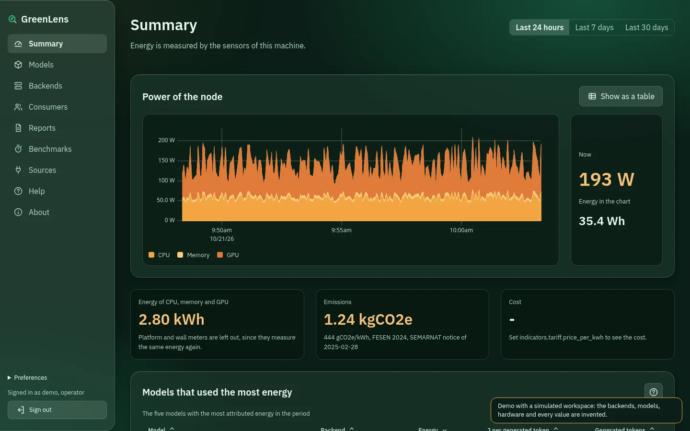
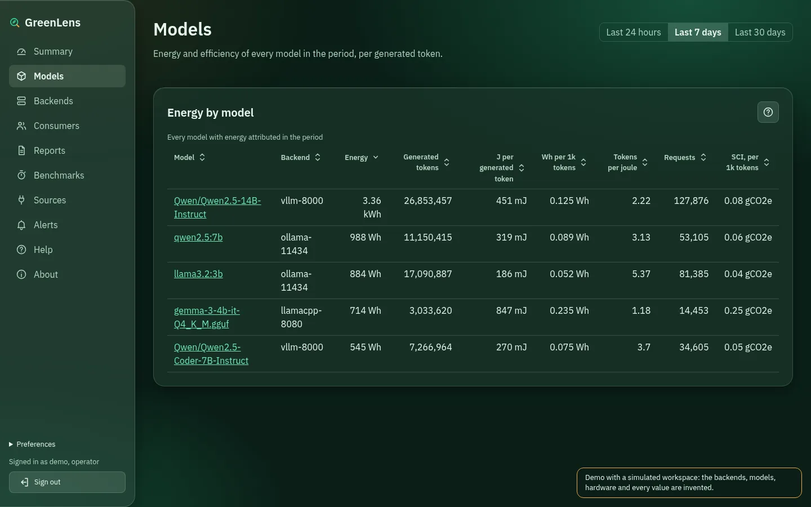
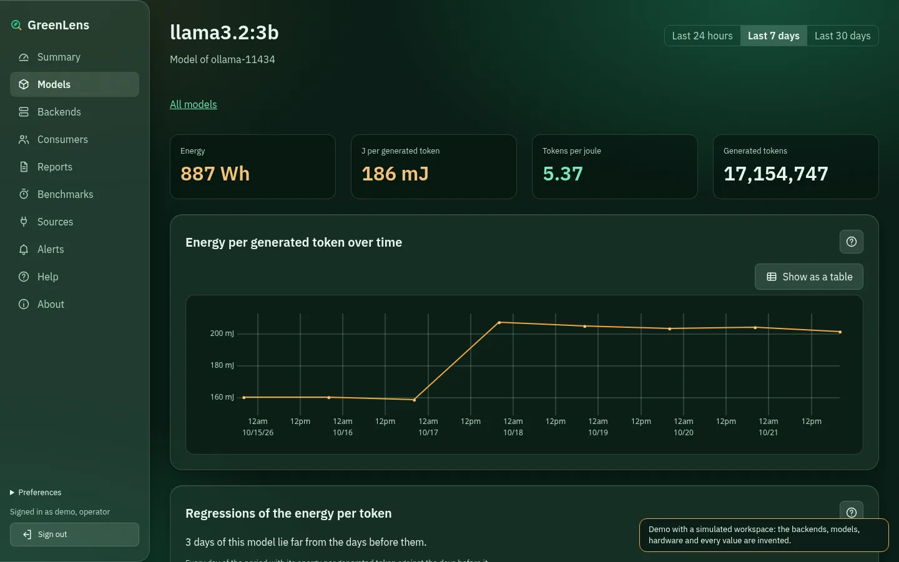
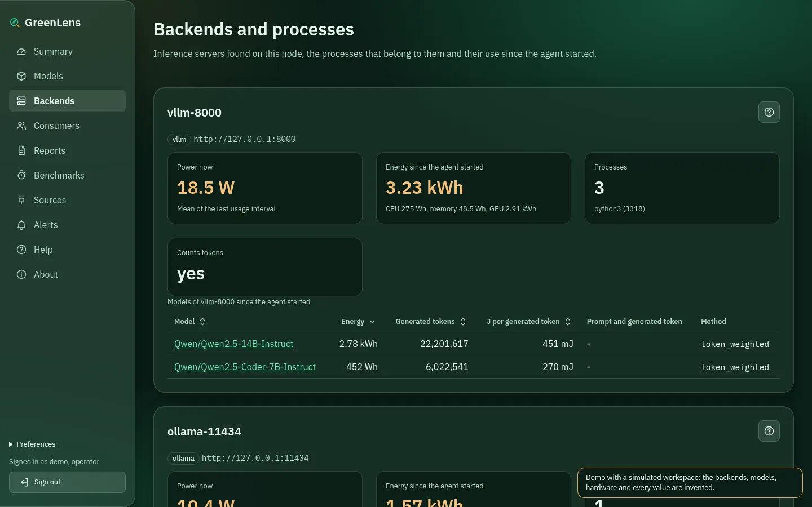
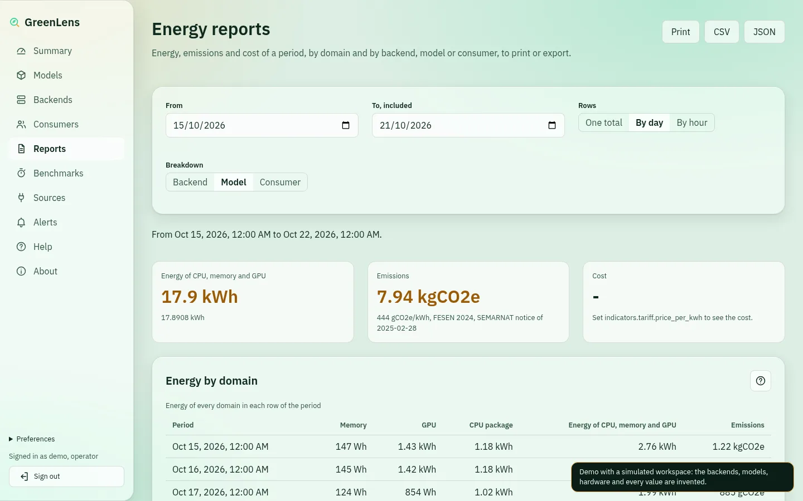

<p align="center">
  
</p>

<p align="center">
  <a href="https://github.com/MarioUrenaGarcia/greenlens/actions/workflows/ci.yml"></a>
  <a href="LICENSE"></a>
  
  
  <a href="https://mariourenagarcia.github.io/greenlens/"></a>
</p>

<p align="center">
  <b>Measure</b> the energy of every model. <b>Attribute</b> it to backends, models and teams. <b>Report</b> kWh, gCO2e, cost and SCI.
</p>

<p align="center">
  <a href="https://mariourenagarcia.github.io/greenlens/demo/?lang=en">Live demo</a> &nbsp;|&nbsp;
  <a href="https://mariourenagarcia.github.io/greenlens/">Documentation</a> &nbsp;|&nbsp;
  <a href="https://mariourenagarcia.github.io/greenlens/docs/tutorials/first-steps/">First steps</a> &nbsp;|&nbsp;
  <a href="README.es.md">Leer en español</a>
</p>

---

GreenLens is an energy observability tool for AI models that run locally on
Linux, from a laptop to a fleet of servers. It is designed to read the energy
counters of CPUs, memory and GPUs, attribute that energy to each inference
backend and model, and report emissions, cost and the Software Carbon
Intensity (ISO/IEC 21031:2024).

<table>
  <tr>
    <td width="33%" valign="top">
      <br>
      <b>Measure</b><br>
      Energy counters from the Linux kernel: RAPL, perf_event, hwmon and GPU
      drivers. Every value declares its quality: measured, attributed or
      estimated.
    </td>
    <td width="33%" valign="top">
      <br>
      <b>Attribute</b><br>
      The energy of the node is split between vLLM, TGI, llama.cpp, Ollama and
      other backends, then between models and teams, using CPU time, GPU usage
      and token counts.
    </td>
    <td width="33%" valign="top">
      <br>
      <b>Report</b><br>
      kWh, gCO2e, cost and SCI per thousand tokens, in the command line, a
      terminal interface, a graphical interface, Prometheus and OpenTelemetry.
    </td>
  </tr>
</table>

## Demo

The [demo](https://mariourenagarcia.github.io/greenlens/demo/?lang=en) runs the graphical interface in your browser over
a simulated workspace: three inference servers, five models and three teams
over five weeks. Every value is invented; nothing comes from a real machine.

<p align="center">
  <a href="https://mariourenagarcia.github.io/greenlens/demo/?lang=en">
    <picture>
      <source media="(prefers-color-scheme: light)" srcset="site/static/images/screens/summary-light-en.webp">
      
    </picture>
  </a>
</p>

<table>
  <tr>
    <td width="50%" valign="top">
      <a href="https://mariourenagarcia.github.io/greenlens/demo/?lang=en"></a><br>
      Energy, tokens and SCI of every model.
    </td>
    <td width="50%" valign="top">
      <a href="https://mariourenagarcia.github.io/greenlens/demo/?lang=en"></a><br>
      Energy per token of a model, with the days it became less efficient.
    </td>
  </tr>
  <tr>
    <td width="50%" valign="top">
      <a href="https://mariourenagarcia.github.io/greenlens/demo/?lang=en"></a><br>
      Backends, their processes and the energy of each model.
    </td>
    <td width="50%" valign="top">
      <a href="https://mariourenagarcia.github.io/greenlens/demo/?lang=en"></a><br>
      Reports by day and by model, to print or export.
    </td>
  </tr>
</table>

## Status

GreenLens measures the energy of the node and attributes it to inference
backends, models and the commands, processes and systemd units you choose:

- `greenlens doctor` finds every energy source, shows which ones are used and
  explains how to fix each problem;
- `greenlens setup-permissions` lets the agent read the sensors without root;
- `greenlens agent` samples every second, stores the data in SQLite and serves
  the other commands;
- `greenlens calibrate`, `measure`, `status` and `report` measure idle power,
  attribute energy and report kWh, gCO2e and cost;
- GPUs are measured through NVML, amdgpu, xe and i915, and the agent finds
  Ollama, llama.cpp, vLLM, TGI, SGLang and LocalAI servers and reports the
  energy of each backend and model, and per generated token;
- `greenlens backup`, `restore` and `export` copy the database and hand
  measurements to other tools as CSV or JSON, and `greenlens license` shows
  the license and where the source code of the running version is;
- `greenlens sci` and `greenlens report --esg` give the Software Carbon
  Intensity of ISO/IEC 21031, with the embodied carbon of the hardware, and
  an environmental report with Scope 2 emissions of the GHG Protocol, as
  tables, JSON or printable pages; emissions and cost can follow an hourly
  profile of the grid and time-of-use prices, and `greenlens report
  --regressions` finds the days a model became less efficient;
- alert rules watch the power of the node and of each backend, the energy
  per token, its regressions and the energy sources, and notify the log,
  journald, syslog or a signed webhook to an internal address, with
  equivalent rules for Prometheus and Alertmanager;
- `greenlens gui` opens the graphical interface the agent serves, with the
  live power, the backends, models and consumers, benchmarks, reports,
  alerts, the configuration and this documentation, all without internet;
- every message is available in English and Spanish, and every error has a
  code, a cause and a fix.

A proxy counts the tokens of Ollama and other OpenAI-compatible servers and
can return the energy of each request, and `greenlens bench` and `compare`
measure models reproducibly and project the savings of switching.
`greenlens top` shows the node, backends and sources live in the terminal.

<p align="center">
  
</p>

## Design

<p align="center">
  
</p>

- **Local first.** Every value is computed and stored on your machine.
- **No telemetry.** No outbound connections by default.
- **Private.** Prompts and responses are never stored or logged; the optional
  proxy reads only their token counts.
- **Least privilege.** The agent runs without root and confines its own file
  access with Landlock.
- **Honest.** Every number comes with its unit, method and quality.

## Requirements

- Linux on amd64 or arm64 with kernel 4.19 or later.
- To build from source: Go at the version declared in `go.mod`, git and make.

## Installation

```bash
git clone https://github.com/MarioUrenaGarcia/greenlens.git
cd greenlens
make build
```

The binary is written to `bin/greenlens`. It is statically linked and has no
runtime dependencies, so it can be copied to any Linux machine of the same
architecture. Next to it, `bin/greenlens-nvml` reads NVIDIA GPUs: it loads
the NVIDIA library, so it is linked dynamically, and it is needed only on
machines with an NVIDIA GPU; keep it in the same directory as `greenlens`.

`make man` writes the manual pages, in English and Spanish, to `dist/man`.

## Configuration

GreenLens works without a configuration file. To change a default, copy
[`deploy/config/greenlens.example.yaml`](deploy/config/greenlens.example.yaml)
to `/etc/greenlens/greenlens.yaml` or `~/.config/greenlens/greenlens.yaml`.
Every key can also be set with an environment variable, such as
`GREENLENS_AGENT_SAMPLE_INTERVAL=2s`. The most common settings:

| Key | Default | Meaning |
|---|---|---|
| `agent.sample_interval` | `1s` | How often energy is sampled |
| `attribution.idle_policy` | `dynamic` | How idle energy is attributed |
| `indicators.emission_factor_g_per_kwh` | FESEN 2024, 444 | Grid emission factor |
| `indicators.tariff.price_per_kwh` | none | Price of electricity, to report cost |

The language of the messages follows `--lang`, `GREENLENS_LANG` or the system
locale. The [configuration reference](https://mariourenagarcia.github.io/greenlens/docs/reference/configuration/)
lists every key.

## Usage

```bash
bin/greenlens doctor
sudo bin/greenlens setup-permissions --apply --user $USER
bin/greenlens agent
bin/greenlens calibrate
bin/greenlens measure -- ollama run llama3.2 "Why is the sky blue?"
bin/greenlens report --from 7d --by day
bin/greenlens gui
```

Every command accepts `--output json`, `csv` or `yaml` for scripts. Exit
codes: 0 success, 1 error, 2 incorrect usage, 3 no measurement source,
4 backend not reachable, 5 insufficient permissions, 6 invalid configuration. The
[first ten minutes](https://mariourenagarcia.github.io/greenlens/docs/tutorials/first-steps/)
tutorial walks through the whole setup.

## Documentation

The documentation site, in English and Spanish, is published at
<https://mariourenagarcia.github.io/greenlens/>. Its sources are in `docs/`
(English) and `docs/es/` (Spanish).

## Development

See [CONTRIBUTING.md](CONTRIBUTING.md). In short:

```bash
make tools
make hooks
make check
```

## License

GreenLens is Copyright (C) 2026 Mario Ureña García and is distributed under
the [GNU Affero General Public License v3.0 only](LICENSE). Organizations that
cannot meet the AGPL obligations can obtain a
[commercial license](COMMERCIAL-LICENSE.md). Third-party components and their
licenses are listed in [THIRD_PARTY_NOTICES.md](THIRD_PARTY_NOTICES.md).
